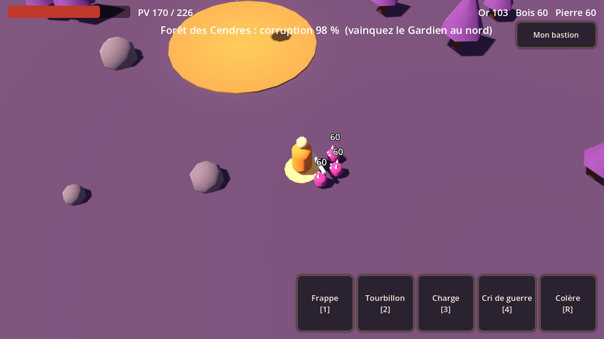
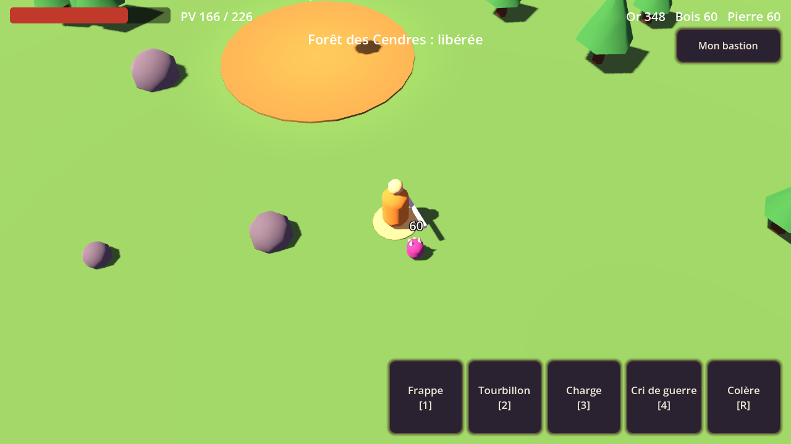
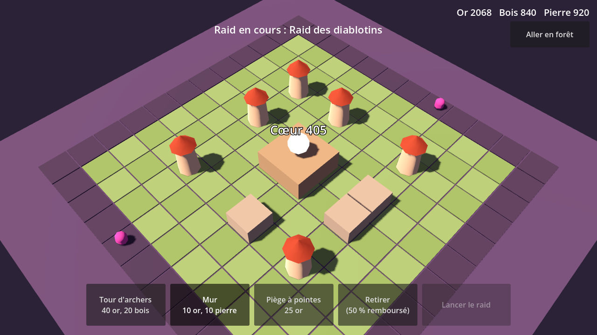

# Age of Demon Kings

Jeu de défense et de reconquête territoriale en 2.5D, pour mobile et PC, avec jeu croisé natif.
Le Roi Démon a conquis le monde, sauf le Sanctuaire. Les joueurs libèrent les forêts, fortifient leur bastion et reprennent les citadelles en guilde.

Statut : **prototype du mois 1**. Formes provisoires (low-poly), pas encore d'art définitif.

| Forêt corrompue | Forêt libérée | Bastion pendant un raid |
|---|---|---|
|  |  |  |

## Contenu du prototype

- Un héros (classe Lame) : déplacement au joystick tactile ou au clavier, attaque automatique, 5 compétences.
- Une forêt avec 3 camps de monstres et un gardien. Battre le gardien libère la forêt.
- Un bastion 12 x 12 : tours, murs et pièges, puis un raid simulé en 3 vagues avec butin ou pertes plafonnées.
- Un serveur Nakama qui fait autorité : compte par appareil, butin des monstres, bastion et issue des raids, plus une première commande Game Master.
- Un panel Game Master web (`gm-panel/`) : joueurs, dons tracés, événements appliqués sans mise à jour du jeu, journal.
- Le jeu fonctionne hors ligne par défaut, et en ligne dès qu'une adresse de serveur est donnée.

## Arborescence

```
client/          Projet Godot 4.7 (GDScript typé)
  data/          Équilibrage en JSON (classes, compétences, monstres, bâtiments, raids)
  src/           core, gameplay, bastion, world, ui
  tests/         Tests unitaires, test de fumée, captures
server/nakama/   Module serveur TypeScript, docker-compose, script de vérification
gm-panel/        Panel Game Master web (voir gm-panel/README.md)
docs/            Architecture et captures
```

## Lancer le jeu sur PC

1. Installer [Godot 4.7](https://godotengine.org/download) (version standard, gratuite, licence MIT).
2. Ouvrir Godot, « Importer », choisir `client/project.godot`.
3. Appuyer sur F5.

Contrôles PC : ZQSD ou WASD pour bouger, clic gauche pour viser ou attaquer, touches 1 à 4 et R pour les compétences, molette pour le zoom.

## Exporter vers Android

1. Dans Godot : Éditeur > Gérer les modèles d'export > télécharger.
2. Installer le JDK 17 et le SDK Android, puis renseigner leurs chemins dans Éditeur > Paramètres de l'éditeur > Export > Android.
3. Projet > Exporter > Ajouter « Android », cocher l'architecture arm64-v8a, puis « Exporter le projet » pour obtenir un APK.

## Lancer les tests

```
cd client
godot --headless --path . --import                       # une fois
godot --headless --path . --script res://tests/run_tests.gd   # 20 tests unitaires
godot --headless --path . --script res://tests/smoke.gd       # partie complète automatisée
```

```
cd server/nakama/modules
npm install
npm test                                                  # compile le module puis 21 tests
```

## Lancer le serveur en local

```
cd server/nakama/modules && npm install && npm run build && cd ..
docker compose up
./smoke_rpc.sh                                            # dans un autre terminal
```

Jouer en ligne avec ce serveur : lancer le jeu avec l'argument `-- --serveur=http://127.0.0.1:7350`
(dans Godot : Projet > Paramètres du projet > Aodk > Serveur Url). Sans adresse, le jeu reste hors ligne.

Test d'intégration client + serveur (serveur lancé) :

```
cd client
godot --headless --path . --script res://tests/online.gd -- --serveur=http://127.0.0.1:7350
```

Console d'administration Nakama : http://127.0.0.1:7351 (identifiants par défaut admin / password, à changer avant toute mise en ligne).

## Règles de travail

- Aucune ressource ni aucun code de Ragnarok Online ou de rAthena.
- Les données d'équilibrage restent dans `client/data` ; le serveur est généré à partir des mêmes fichiers.
- Le serveur décide. Le client ne fait que demander.
